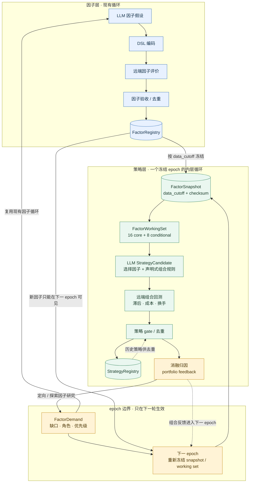

# GF 基本面量化智能体：因子到组合的双时间尺度策略层

状态：**已实现并完成真实 API + 远端回测验证（2026-09-01）**。

这份文档说明新增策略层如何工作、它如何严格复用并联动现有因子层，以及一个
`epoch` 内外两层循环实际发生什么。它描述的是当前代码的运行边界，不是另一套
平行系统。

## 1. 一句话定位

原系统解决的是“发现并验收一个因子”。新增策略层解决的是“从一组已经登记的因子
中，构建、回测、验收并登记一个可交易组合；再把组合层的证据反馈给下一轮因子研究”。

整体链路如下：



实线表示本轮主流程，虚线表示只读查询或传递到下一 `epoch` 的反馈；因子研究仍复用
上方的现有因子循环，不会把新因子倒灌进正在运行的策略试验。

这是一种“分层骨架 + 受限声明式规则”的实现：LLM 可以选择因子、组合规则和参数，
但不能生成回测代码。选股、加权、调仓、成本、滞后和评价都由确定性框架执行，避免
把前视偏差或不可复现逻辑重新引入系统。

## 2. 与原有因子层的关系

策略层**不修改** `FactorCandidate` 的语义，也不把策略指标混入因子 registry。
二者通过明确的只读输入和反馈对象连接。

| 因子层既有对象/入口 | 策略层如何使用 | 不做什么 |
|---|---|---|
| `rdagent/app/gf_rd_loop/factor.py` | 继续负责因子提出、编码、远端评价、验收和登记 | 不被策略层替换 |
| `FactorRegistry` | 为每个 epoch 提供已登记因子的 ID、表达式、方向、家族、指标、远端产物路径和 checksum | 策略层不直接篡改 registry 中的历史因子记录 |
| `FactorCandidate` | 仍是单因子研究对象 | 不给它增加策略字段，也不拿单因子 IC 门槛评价策略 |
| 因子 DSL / 远端 worker | 仍用于因子研究；策略研究提出的新因子最终仍走同一条因子验收链 | 不由 LLM 编写新的回测脚本 |
| `FactorAcceptanceService` | 接收由策略需求驱动的定向/探索因子研究产物 | 不因一次策略失败自动放宽因子门槛 |

新增策略域位于 `rdagent/scenarios/gf_quant/strategy/`，有自己的
`StrategyCandidate`、`StrategyAcceptanceService` 和 `StrategyRegistry`。
这是必要的隔离：一个因子的 RankIC、覆盖率、换手和一个组合的年化、回撤、Sharpe、
成本后超额收益是不同层级的证据。

## 3. 核心对象与数据契约

### 3.1 因子快照：切断当前轮与未来信息

`FactorUniverseSnapshot` / `FactorSnapshotItem` 将某个 `data_cutoff` 时刻的因子
登记表冻结为不可变清单。每个条目携带因子 ID、名称、家族、表达式、方向、指标、
远端 artifact 路径和 checksum；快照本身也有 ID 与 checksum。

快照不是按“最早到最新”机械截断：它保留历史 registry 的可用因子宇宙。随后
`FactorWorkingSet` 按准入层级、相关性簇、经济主题、稳定性和上一轮组合反馈选择
可供策略提案的较小集合。当前默认工作集为 24 个：16 个 `core`，8 个
`conditional`。`conditional` 的含义是技术和 PIT 条件合格、但可能更适合作为组合
互补项或风险控制项，不能因为固定单因子多空规则表现一般而被永久排除。

快照一经写入便不再改动。当轮因子研究产生的记录只能被下一轮新快照看到，绝不
倒灌到已经开始的策略试验。

### 3.2 策略候选：声明式而非可执行代码

`StrategyCandidate` 由 `proposal.py` 中的 `LLMStrategyProposalEngine` 生成，核心字段是：

| 字段 | 含义 |
|---|---|
| `factor_names` | 2–8 个、且必须属于当前冻结 working set 的因子名称 |
| `rule` | 声明式选样/排序规则；可与因子分数组合，不是 Python 回测代码 |
| `universe` | 股票池声明 |
| `CompositionSpec` | `top_n`、`equal`/`rank`/`proportional` 加权、可选单票上限 |
| `BacktestSpec` | 至少 1 日信号滞后、年化交易日数；不含任何成本字段 |
| `hypothesis` / `metadata` | 经济逻辑、提案来源和审计元数据 |

组合构造函数 `build_target_weights` 将截面分数与可投资掩码变成目标权重：筛选后
取 Top-N，按等权、名次或分数比例分配，再以确定性的 water-filling 处理权重上限。
若“持仓数 × 权重上限 < 1”，剩余部分明确是现金，不会违反单票上限来强行满仓。

`BacktestSpec.signal_lag` 的下限是 1；`0` 会在对象构造和验收处被拒绝。交易成本不是
策略参数，而是 `costs.py` 定义的系统执行契约：中国 A 股简化费率固定为买入 10 bps、
卖出 10 bps，完整往返 20 bps。它不能由 LLM、candidate、CLI、环境变量、settings、
orchestrator config 或 acceptance policy 覆盖；旧 candidate payload 中的 `cost_bps` 仅在
本地读取时被忽略。

本地回测按每次权重变化分别计算 `max(new-old, 0).sum()` 与
`max(old-new, 0).sum()`，初次建仓只扣买入费、清仓只扣卖出费、换仓同时扣两侧。远端
request 在 candidate 之外注入顶层 `execution_costs={buy_bps: 10, sell_bps: 10}`；独立
worker 必须核验字段和值完全匹配才执行。验收门核对 evaluation metrics 中的
`buy_cost_bps=10`、`sell_cost_bps=10`、`round_trip_cost_bps=20`，registry 和 epoch report
同时保存这三个事实，因而模型无法通过报价或省略成本影响结果。

### 3.3 策略评价和登记

每个候选由 `EpochBoundStrategyService` 绑定到**刚刚冻结的** snapshot、working set 和
评价窗口，再调用 `RemoteStrategyEvaluator`。远端前先由 `artifacts.py` 仅物化候选实际
引用的因子到独立目录，并记录清单和 checksum；远端
`scripts/gf_quant_strategy_worker.py` 输出固定双边成本后的收益、年化/超额年化、Sharpe、最大回撤、
换手、持仓数、逐年指标、日度收益摘要和逐因子消融贡献。

返回结果进入 `StrategyAcceptanceService`：

1. 先执行 fail-closed 门槛：滞后、固定成本口径、覆盖、持仓数、换手、回撤、年度
   稳定性和指标是否完整；
2. 通过门槛后，将日度组合收益与已接受策略做相关性去重；
3. 写入独立的 `StrategyRegistry`，保存规格、引用因子、指标、远端 artifact/checksum、
   年度门槛、去重依据和紧凑收益轨迹；
4. 状态为 `accepted`、`duplicate` 或 `rejected`。`duplicate` 表示表现相近、已能由
   一个 accepted 策略覆盖，并不等于回测失败。

策略服务仅只读查询 `FactorRegistry`，把每个引用因子的 ID、家族和状态存入策略元数据，
从而让一个组合可以追溯到它使用的因子。

## 4. 双时间尺度循环：实际时序

### 内层：在一个固定因子世界中试组合

`GFQuantOrchestrator.run_epoch()` 按以下顺序运行：

1. 用本轮 `data_cutoff` 从 `FactorRegistry` 冻结 snapshot，并生成 working set；
2. 将 snapshot、working set、epoch ID 及 `evaluation_start/end` 绑定到策略服务；
3. LLM 每次只看当前 working set、先前试验摘要和同一评价窗口，提出一个
   `StrategyCandidate`；
4. 校验候选引用范围，远端回测，策略 gate，策略去重，并登记结果；
5. 重复至本轮试验预算（默认 10 条，CLI 可调）。

因此，同一 epoch 的所有策略共享完全相同的因子快照。哪怕中途有新因子被研究出来，
它也不可能被插入本轮 working set。

### 外层：从组合失败和消融中改进因子研究

策略试验完成后，`aggregate_factor_contributions()` 聚合各组合中“去掉某因子”带来的
边际年化、Sharpe、回撤和换手变化。`derive_factor_demands()` 将弱贡献、负贡献或明确
的组合缺口转换为 `FactorDemand`：包括目标家族、经济主题、预期角色、优先级、证据和
应避免的因子 ID。

`DemandDrivenFactorResearchEngine` 随后执行两类研究：

| 研究类型 | 输入 | 用途 |
|---|---|---|
| 定向研究（targeted） | `FactorDemand` | 针对组合暴露不足、替代/互补需求提出因子 |
| 独立探索（exploratory） | 与具体 demand 无关 | 避免研究只在既有局部最优附近打转 |

这些研究仍复用原来的因子提案、DSL、远端因子 worker、因子验收和因子 registry。外层
不会把未通过因子 gate 的候选直接塞进策略层；它只把“策略层发现了什么缺口”作为下一次
因子研究的优先级信息。

当 epoch 结束时，组合消融的有限数值会留在 orchestrator 的
`portfolio_feedback` 中。下一次 `run_epoch()` 才用它重新挑选 working set：正贡献因子
优先，负贡献因子后置，无证据者保留原有质量排序。反馈不会改写旧快照，因此整条链仍可
复现。

## 5. 评价窗口、PIT 与跨 epoch 约束

多 epoch 运行必须提供各轮自己的 `data_cutoff`、`evaluation_start` 和
`evaluation_end`。`--epoch-windows` JSON 文件由 `load_epoch_windows()` 读取，并强制：

* 每轮窗口字段齐全且为 ISO 日期；
* 评价开始不晚于结束；
* 后一轮三个日期字段都不倒退；
* 后一轮评价窗口不与前一轮重叠。

策略服务会根据窗口跨越的自然年数调整年度稳定性 gate：单年窗口要求 1 个有效且正收益
年度；多年度窗口维持更严格要求。这样不会因为“单年窗口不可能满足两年门槛”而产生
结构性误拒绝。

## 6. 运行入口、输入与输出

统一 CLI 入口是：

```powershell
python -m rdagent.app.cli strategy `
  --epochs 2 `
  --trials-per-epoch 2 `
  --targeted-factor-rounds 1 `
  --exploratory-factor-rounds 1 `
  --epoch-windows git_ignore_folder/strategy_epoch_windows.json `
  --report-dir artifacts/live/strategy_epochs `
  --snapshot-dir git_ignore_folder/gf_quant/snapshots
```

每个 epoch 会产生三类审计产物：

| 产物 | 内容 | 作用 |
|---|---|---|
| snapshot JSON | 因子条目、`data_cutoff`、snapshot checksum | 证明本轮可见因子集合 |
| epoch report JSON | 策略规格、状态、gate、指标、贡献、demand、因子研究摘要 | 证明内外循环的输入输出 |
| registry / 远端 artifact | accepted/duplicate/rejected 记录、因子溯源、远端路径和 checksum | 支持复跑、去重和复核 |

epoch 内的单条试验或远端请求失败会写入该条/该轮报告，不会丢弃之前已完成的 epoch；
这让长时间研究可以继续运行，同时保留故障证据。

## 7. 用中证自由现金流指数理解组合规则层

中证自由现金流指数是一个很好的“策略规格，而非新因子”的例子。其具体样本数、权重
上限和调样月份必须以官方编制方案为准，系统不把未核实数值写死；但其规则可映射为：

| 指数思想 | 系统表达 |
|---|---|
| 指定股票池 | `StrategyCandidate.universe` |
| 流动性、行业、连续现金流等条件 | `rule` 对应的可投资掩码 |
| 自由现金流率排序 | 截面 score 或基本面规则 |
| 取排名前 N | `CompositionSpec.top_n` |
| 自由现金流率加权 | `CompositionSpec.weighting="proportional"` |
| 单票权重上限 | `CompositionSpec.weight_cap` |
| 定期调样与滞后执行 | 调仓规则 + `BacktestSpec.signal_lag` |

这也解释了为何策略层不是“让 LLM 直接写指数回测”：LLM 负责提出一份可审阅规格，
框架负责无前视地执行同一份规格。

## 8. 已验证的运行事实

在 2026-09-01 的真实 API 与远端 worker 运行中，系统完成了两个不重叠的单年 epoch：

* 2024 epoch 的两条组合年化为 14.99% 与 23.59%；
* 2025 epoch 的两条组合年化为 56.84% 与 53.31%；
* 两轮策略均有远端 artifact 路径与 checksum；
* `pct_change(adjclose, 1)` 在真实定向因子研究中成功执行；
* Epoch 0 研究得到的新因子只在 Epoch 1 snapshot 出现；Epoch 1 的组合反馈非空；
* 已接受策略 `lowvolliqrevvalue_20260901_t00` 的两年验证年化为 45.20%，
  超额年化 21.43%，Sharpe 1.303。

最新 epoch 中标为 `duplicate` 的策略并非 gate 失败，而是与已登记的 accepted 策略
收益轨迹高度相似。这说明策略 registry 的去重机制正在生效。

## 9. 当前边界与后续配置决策

这套机制已经闭环，但研究口径仍应由使用者配置，而不是由 LLM 暗中决定：基准指数与
股票池、金融地产处理、调仓频率、停牌/涨跌停处理、行业/风格约束、训练验证测试切分，
以及策略去重阈值。交易成本不在这些可配置口径中：系统固定买入 10 bps、卖出 10 bps
（见 3.2），策略智能体和运行调用方都不能修改。冲击成本等更细模型不在当前简化契约内。
中证自由现金流规则也应在取得官方方案后再作为
某个可复用的正式策略模板固化。

因子家族（基本面与价量）产出数量失衡属于独立问题；本策略层只消费经登记的因子，并
通过 `FactorDemand` 提供组合层面的研究方向，不承担该家族配额问题的调度职责。
