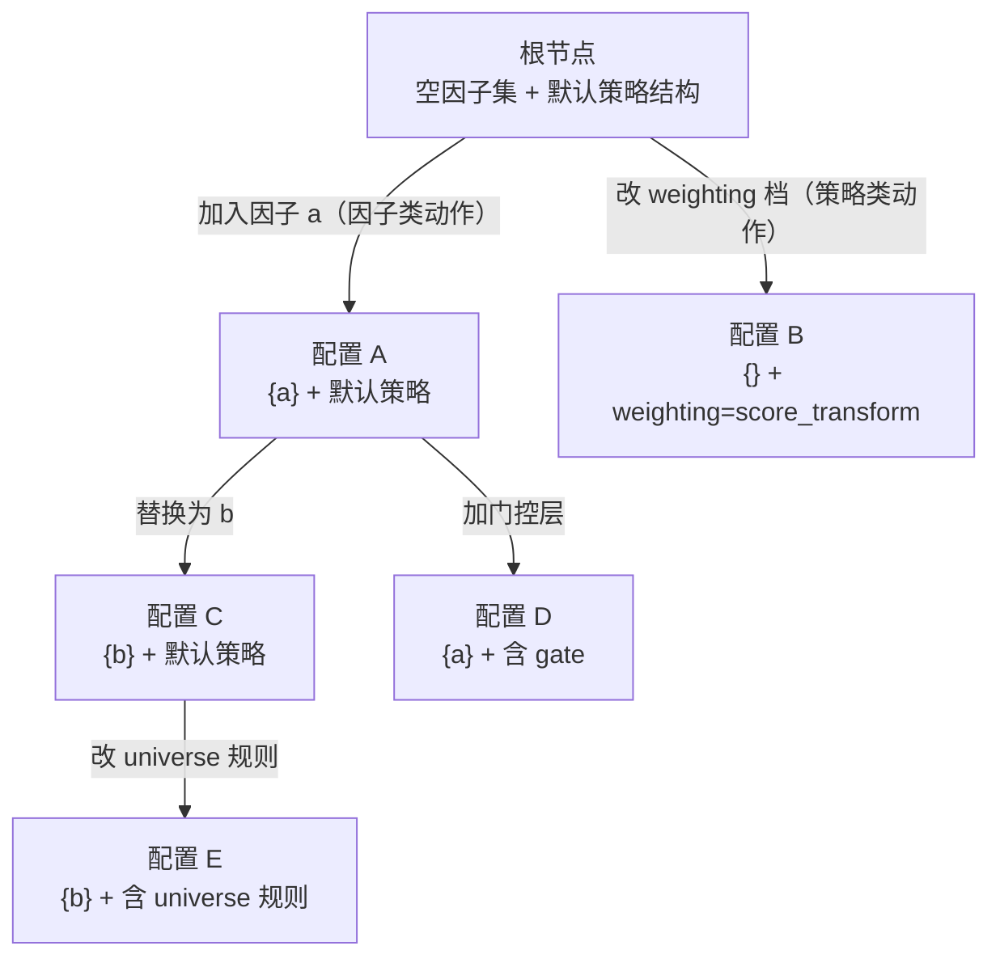

# 因子策略智能体 MCTS 联合搜索方案

来源：广发证券 gf-agent 仓库对因子智能体与策略智能体协作流程的重构设计；以 MCTS（蒙特卡洛树搜索，即通过大量模拟+回传积累节点价值的搜索算法）为骨架，让因子选择与策略组合结构在同一棵树上联合生长。

## 目录

- 方案 A：单棵联合动作树
  - 保留与推翻的范围
  - 核心结构
  - 回测参数的全局统一
  - 动作生成
  - 评估与标量 Q
  - 预算与搜索
  - 一次搜索运行的生命周期
  - 风险与开放问题
- 方案 B：bandit 调度式协同（退路）
- 资料源附录

## 方案 A：单棵联合动作树

### 保留与推翻的范围

保留（个体能力层，不动）：
- 策略侧 `rdagent/scenarios/gf_quant/strategy/` 下全部算子与 spec 模块：`signal`、`gating`、`universe`、`composition`、`backtest`、`execution`、`costs`、`audit`、`walk_forward`、`deployment`、`manifest`、`reproducibility`、`artifacts`。
- `scripts/gf_quant_strategy_worker.py`，策略 registry 与验收服务。
- 因子侧 `rdagent/scenarios/gf_quant/mining.py` 的 `RDAGentDSLProposer`（DSL 即领域特定语言，这里指因子表达式语法）。
- `rdagent/scenarios/gf_quant/service.py` 的 `FactorAcceptanceService`（RankIC 验收链，RankIC 即因子值与未来收益在截面上的排序相关性，验收链按它做门槛筛查）。
- 因子侧 registry、dedup、benchmark、remote（因子远程评价）。

推翻（协作流程层，逐条说明理由）：
- `snapshot.py` 的因子宇宙冻结与 working set 机制。理由：它是冻结式协作的基础，与增量续树、按需取用 registry 的新机制冲突；因子池改为直接读 registry 的 accepted 记录。
- `orchestrator.py` 的双层顺序循环（外层 epoch + 内层固定 trial 数，见 `rdagent/app/gf_rd_loop/strategy.py:134` 外层、`orchestrator.py:460` 内层）。理由：固定外层 epoch 把搜索切成不相干的子任务，无法跨子任务积累节点统计，也无法让回测预算连续调度。
- `derive_factor_demands` 聚合派生流程（`orchestrator.py:253-325`）。理由：它是把策略端的需求攒到 epoch 末尾再喂给因子端的串联式聚合，会让「因子 X 在策略结构 Y 下更有价值」这类条件信号丢失。
- epoch 概念本身。理由：搜索进度用预算充足率（后文的 φ）连续表达，不需要离散阶段。
- 因子提案读 epoch 末聚合反馈的模式。理由：粒度太粗；改为读当前节点的树上下文。

### 被推翻机制的下游接口去向

`manifest`、`reproducibility`、`deployment` 与验收服务（`StrategyAcceptanceService`）这几个模块保留的是格式与内容生成逻辑，被推翻的只是它们吃进去的 provenance 输入。原实现里它们的 provenance 字段（`snapshot_id`、`working_set_id`、`snapshot_checksum`、`working_set_snapshot_checksum`，定义见 `strategy/service.py:410-412` 的 `REPRODUCIBILITY_IDENTITY_FIELDS`，使用见 `strategy/service.py:453-535`）都来自冻结快照。快照机制推翻后，这些 provenance 字段改由「节点身份哈希 + 搜索运行元数据（运行 ID、sidecar 版本）」产生。`snapshot_id` 与 `working_set_id` 这两个概念随之废弃，不再出现在 payload、registry 与 manifest。评估环境由树路径上的配置唯一确定，任意两个节点的差异都能被哈希与元数据区分开。

### 核心结构

树节点 = 一个完整配置：因子集 + 策略组合结构（`signal`、`gating`、`universe`、`composition` 的 spec）。节点不含回测参数。

节点身份 = canonical 配置哈希（canonical 即规范唯一化，对字典按 key 排序后再序列化），复用现有 `strategy_id` 机制。canonical payload 已经包含因子名列表与全部策略 spec 字段，新增字段时按「默认关闭则不进 payload」原则，不破坏现有 strategy_id 语义。

边 = 单步动作，两类：
- 因子类动作：加入一个因子、替换一个因子、移除一个因子。
- 策略类动作：改一项 spec 字段的档位，例如 `weighting` 档、`gating` 层、`universe` 规则、`signal` 阶段参数。

树统计（Q 值即节点价值的标量估计、访问数、子节点集合、路径序列）存 sidecar 文件（sidecar 即与主数据并列存放的辅助文件）。registry 语义不变，registry 不参与树统计。

无 epoch 概念。一次搜索运行 = 固定总预算；运行结束后树写入 sidecar；下次运行续树（追加预算）。跨运行去重的键是「路径 + 配置哈希」：树中的位置身份由路径决定，同一配置出现在两条路径上时统计分开记；配置哈希另有用途，同一配置的评估结果缓存复用、不重复回测。

### 回测参数的全局统一

回测参数不该由智能体决定，应全策略一致：节点之间要可比，评估与执行口径就必须是常量。

评估口径（回测区间、成本假设、交易日数）与执行假设（调仓频率、最小持有期等 `BacktestSpec` 字段）全部提升为运行级全局配置。这些字段不进入树节点、不进入动作空间，动作空间只剩因子选择与策略组合结构，所有节点天然同口径可比。

由此带来的两个事实：
- 策略提案引擎（`strategy/proposal.py:613-656`）就地构造 `BacktestSpec` 的现有写法改为只产组合结构字段，`BacktestSpec` 由运行级配置注入。
- 因子提案器读当前节点的策略结构与当前因子集的历史表现，两类动作生成时拿到的执行假设都是常量。

### 动作生成

因子类动作的候选来源：
- registry 中 accepted 的既有因子。
- 新提案因子。新因子由 `RDAGentDSLProposer`（`rdagent/scenarios/gf_quant/mining.py:19-70`）按树上下文生成：上下文含当前节点的策略结构、当前因子集、已尝试过的失败动作（含 gate 失败信息）。新因子先过现有 RankIC 验收链（`rdagent/scenarios/gf_quant/service.py:288-353`；RankIC 门槛装配见 `benchmark.py:1146-1238`；需求驱动研究的驱动参数 `max_attempts=3`（每轮候选上限）与 `stop_on_acceptance=True`（提前停止开关）见 `factor_research.py:157-158` 的 `DemandDrivenFactorResearchEngine`；远程评价计入统一预算），过门槛才有资格作为树中的因子类动作。

策略类动作由 `LLMStrategyProposalEngine`（`strategy/proposal.py:44-663`）按树上下文生成 spec 变更；其词表与 fail-closed 校验（fail-closed 即校验不通过直接拒绝、不静默修正）不变。

两类提案引擎都被同一个选择—扩展—模拟—回传循环调用，被同一个 Q 评估。协同具体落在三处：
- 因子提案读策略结构缺口（哪些信号阶段还没有有效因子、哪些门控层缺判别能力）。
- 策略提案读当前因子池（因子池的信噪比决定该用哪种 weighting 档、是否需要 gating、是否需要 universe 规则过滤）。
- 「因子 X 只在某策略结构下有价值」这种条件性由树的统计自然捕获，不需要在动作生成器里硬编码规则。

### 评估与标量 Q

现有代码没有把回测指标折算成标量的统一函数（仓库无 reward / objective_value / scalar_score / composite_score 命中）。策略侧只有布尔门槛（年化 ≥ 0.08、超额 ≥ 0、正收益年数 ≥ 2 等，见 `strategy/service.py:132-193` 与装配 `strategy.py:487-491`）；因子侧存在用于排序的标量（快照内的质量分与稳定性分、跨 epoch 的边际贡献均值 `_portfolio_feedback`），但从未与策略侧合并成统一评分。其中 `_portfolio_feedback`（`orchestrator.py:487-491` 写入、`orchestrator.py:445` 参与工作集选取）是「回测标量驱动选择」的既有先例，但只作用于工作集排序，不是树搜索意义上的奖励。

Q 默认取超额年化收益 `excess_annualized_return`（本地引擎 `backtest.py:100-111` 的 `_relative_performance` 已产出）为唯一绩效标量。现有布尔门槛原样保留为硬约束：不过门的节点 Q 视为无效、不参与均值与排序（访问数的处理见下段）。标量口径是可配置项，可换成 Sharpe（夏普比率，即单位风险下的超额收益）或信息比（超额收益与跟踪误差之比）。

不过门节点的 Q 无效时不参与均值与排序，但访问数照常统计、允许被选中、被继续生成子节点——它的子配置可能被后续动作救活（例如把导致整体不过门的因子换掉）。选择阶段对尚无有效 Q 的节点按「未充分探索」处理（访问数少则靠先验与探索项选出），这样搜索早期（几乎所有新节点都先撞硬约束）树也能正常展开。收束时按 Q 排序选最优、硬筛不变。

Q 只负责衡量「好多少」，风险类指标（最大回撤、波动率等）负责衡量「能不能要」。这一分工与「RankIC 只作门槛、不进 Q」同构。

Q 沿路径回传到所有祖先节点；节点的访问数、子节点集合、平均 Q 按访问聚合更新。

### 预算与搜索

机制直接借鉴 BG-MCTS（arXiv 2602.09574）。

三类远程调用（组合回测、因子远程评价、审计重跑）全部计入同一预算。预算数字是运行级可配置的初值：单次搜索运行总预算默认 12 个额度，组合回测 1 次 = 1 额度、因子远程评价 1 次 = 1 额度、审计重跑 1 次 = 1 额度，每次扩展的评估消耗 1 额度。这个量级继承现有一轮 epoch 的调用规模（`orchestrator.py:50-57`：10 次组合回测加两档因子研究轮）与旧方案的「10 次基础 + 2 次增量」，是设计初值，不是实测值；数据机恢复后按真实成本重新标定。

预算充足率（φ = 1 − 已用额度 / 总预算）作为连续信号参与搜索，不只是停止条件。φ 一共有三个作用点。选择阶段用 BG-PUCT 公式：标准 PUCT 的选择分数是 Q(s,a) + c · P(s,a) · √(ln N(s) / (1 + N(s,a)))，前一项是历史平均价值（利用项），后一项是探索加成（访问少的分支得高分）。BG-PUCT 在探索项上直接乘 φ，变成 Q(s,a) + φ · c · P(s,a) · √(ln N(s) / (1 + N(s,a)))，φ 从 1 退到 0，探索项线性熄火；这等价于把探索系数做成随 φ 冷却的 c · φ。第二个作用点是深度修正项 φ(1 − φ) · d / d*，它加在节点的 Q 值上，选择分数的公式本身不动（φ 在中段最大、两端为零，预算走到一半时把选择偏向有产出能力的深节点；d 为节点深度，d* 为参考深度）。第三个作用点是扩展阶段的「虚拟生成子节点」机制：扩展动机 E_gen = μ(p) + φ · √σ²(p)（μ(p) 为父节点平均 Q、σ²(p) 为父节点 Q 的方差，预算多时偏大，预算少时迅速熄火），预算耗尽时扩展自动熄火。三处都没有显式阶段切换阈值，全部是 φ 的连续函数。

φ 是单次搜索运行内的信号，预算按运行独立重置；跨运行的探索与利用延续由树的历史统计（访问数、Q）承担，不依赖 φ 在运行之间连续。这与 BG-MCTS 的实例级预算口径一致。

评估主路径直接远程回测。原「远程回测昂贵、本地模拟替代」的设想没有实测依据——数据机不可达期间无法测量远程单次成本，是否昂贵要等恢复后实测。因此分层模拟只留底、不进入第一版实现：本地引擎（`backtest.py:63-97` 的 `_performance` 已完整实现，parity 测试保证与 worker 逐位一致）具备跑完整回测的能力，若未来实测远程成本确实高，再启用「本地模拟出 Q 代理、远程只确认关键节点」的分层。本地数据副本当前不存在，届时可用本机已授权的 rqdatac 拉取并缓存，本地数据与数据机数据的口径差异（复权方式、财务数据时点）作为该机制的已知风险保留。

提案引擎输出的动作概率作为上式中 PUCT 的策略先验 P(s, a)。

### 一次搜索运行的生命周期

启动：
1. 加载 sidecar（存在则续树、不存在则新建根节点）。
2. 根节点配置 = 空因子集 + 默认策略结构（所有 spec 字段留默认）。
3. 注入运行级全局配置（回测参数、执行假设），动作空间收缩到因子与组合结构。

循环：
1. 选择：从根节点沿 PUCT 选择到叶（叶 = 未完全展开的节点或终态节点）；探索项与深度修正项都吃 φ。
2. 扩展/提案生成：在选中节点上调用提案引擎产一个或多个候选动作；候选先过本地校验（spec 合法、字段齐）。新建子节点并写 sidecar。
3. 模拟：对新扩展节点直接远程回测得 Q（消耗 1 额度）。分层模拟是留底的可选机制，第一版不启用。
4. 回传：Q 沿路径聚合到各祖先。

收束：预算耗尽后，按 Q 排序取最优配置（叠加现有硬约束再筛一遍），走现有 `StrategyAcceptanceService` 登记 registry。

### 风险与开放问题

- 远程回测的真实成本（单次耗时、排队与并发上限）待数据机恢复后实测；分层模拟的取舍要拿到实测数字后重新评估。数据机不可达期间端到端验证受限。若未来启用分层模拟，本地数据与数据机数据的口径差异是 Q 偏差的根源。
- 动作空间大，LLM 提案质量决定搜索成败。树只是框架，提案器是上限。需要保留现有 fail-closed 校验、词表与黑名单。
- 现有 registry 每 trial 都写一行且无清理机制（`strategy/service.py:638, 670` 两条路径都 upsert），sidecar 沿用同模式会膨胀。新设计需给 sidecar 定存续与修剪策略（如按 Q 排序保留前 N、丢弃长期无访问的节点）。
- 现有 parity 测试守护本地与 worker 两端逐位一致，任何执行层改动必须两端同步、不能只改一端。
- 稳健性警示（SoK 综述 arXiv 2609.19705）显示学术 LLM 交易方案 80% 在至少一项稳健性指标上失败。保留 fail-closed 门槛与风控约束是新方案仍要守住的红线。

## 方案 B：bandit 调度式协同（退路）

以 R&D-Agent-Quant（arXiv 2505.15155）为蓝本：动作空间为 {因子, 模型} 二值选择，多臂老虎机（贝叶斯线性回归 bandit，即把每条臂的收益参数化为一元线性回归、用观测收益更新后验）调度下一步走哪条臂，研究与开发交替，评估统一为回测反馈。

与原论文的一处分歧——该论文把 IC、ICIR、RankIC、RankICIR 放进奖励向量，而本方案按用户原则把它们降级为门槛、奖励只用回测标量；适用场景是方案 A 树维护太重或动作生成质量不行时，退回 bandit 调度式协同作为过渡形态。

## 资料源附录

### 外部文献

- Tree of Thoughts：https://arxiv.org/abs/2305.10601 — LLM 树搜索的起点，动作=思维单元，LLM 自评回报。
- Math-Shepherd：https://arxiv.org/abs/2312.08935 — MCTS rollout 训练过程奖励模型。
- AlphaMath Almost Zero：https://arxiv.org/abs/2405.03553 — MCTS rollout 产过程监督。
- MCTSr：https://arxiv.org/abs/2406.07394 — MCTS 自精炼数学推理，节点四步循环。
- rStar-Math：https://arxiv.org/abs/2501.04519 — 小模型 MCTS 深度思考与自演化。
- AlphaLLM-CPL：https://arxiv.org/abs/2410.06508 — MCTS 轨迹对偏好学习。
- BG-MCTS：https://arxiv.org/abs/2602.09574 — 预算感知 MCTS，本方案预算机制的来源；代码 https://github.com/Sora-Miyamoto/bg-mcts。
- R&D-Agent：https://arxiv.org/abs/2505.14738 — 通用框架；仓库 https://github.com/microsoft/RD-Agent。
- R&D-Agent-Quant：https://arxiv.org/abs/2505.15155 — 因子模型联合优化，方案 B 蓝本。
- Alpha-GPT：https://arxiv.org/abs/2308.00016 — 人机交互式 alpha 挖掘。
- TradingAgents：https://arxiv.org/abs/2412.20138 — 多 agent 交易台。
- FinCon：https://arxiv.org/abs/2407.06567 — 层级通信 + 言语强化。
- FinRL-X：https://arxiv.org/abs/2603.21330 — 以 weight 为中心的统一管线。
- SoK Trading Agents：https://arxiv.org/abs/2609.19705 — 学术 LLM 交易方案稳健性评估，风险警示来源。
- 符号回归先验：https://arxiv.org/abs/2304.06333 — 因子表达式的符号回归先验思路。
- 符号回归教程：https://arxiv.org/abs/2512.15920 — 符号回归实现细节参考。

### 内部代码锚点

双层循环：
- `rdagent/app/gf_rd_loop/strategy.py:134` — 外层 for 循环。
- `strategy.py:529-615` — main 装配。
- `rdagent/scenarios/gf_quant/strategy/orchestrator.py:419-526` — 每轮实时序。
- `orchestrator.py:460` — 内层 trial 循环。
- `orchestrator.py:50-57` — 预算与工作集默认值。

快照冻结：
- `orchestrator.py:440-446`。
- `strategy/snapshot.py:131-157` — `FactorSnapshotItem` 字段。
- `snapshot.py:423-465` — working set 构建。

需求派生：
- `orchestrator.py:253-325` — `derive_factor_demands`。

提案引擎：
- `strategy/proposal.py:44-663` — `LLMStrategyProposalEngine`。
- `proposal.py:613-656` — `BacktestSpec` 就地构造。

因子提案器与验收链：
- `rdagent/scenarios/gf_quant/mining.py:19-70` — `RDAGentDSLProposer`。
- `rdagent/scenarios/gf_quant/service.py:288-353` — `FactorAcceptanceService`。
- `benchmark.py:1146-1238` — RankIC 门槛。
- `factor_research.py:157-158` — `DemandDrivenFactorResearchEngine` 的 `max_attempts=3` 与 `stop_on_acceptance=True`。

策略布尔门槛：
- `strategy/service.py:132-193`。
- 验收门 0.08 / 0.0 / 2 装配于 `strategy.py:487-491`。

标量分数函数的事实：全仓库无 reward / objective_value / scalar_score / composite_score 命中。

树痕迹：当前代码 0 处；上游 `rdagent/core/proposal.py:131-204` 的 `Trace.dag_parent` 为有定义无实现的死骨架。

本地回测引擎：
- `strategy/backtest.py:63-97` — `_performance`。
- `backtest.py:100-111` — `_relative_performance` 产 `excess_annualized_return`。

registry 无清理机制：
- `strategy/service.py:638, 670` — 两条路径都 upsert。