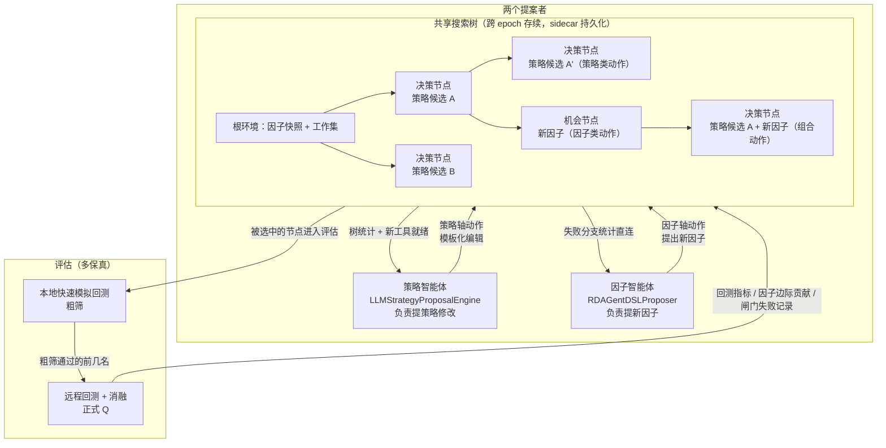

# GF 策略层 MCTS（蒙特卡洛树搜索）改造方案：覆盖全流程的共享搜索树

状态：**方案，未实现（2026-09-17）**。本文档是后续执行的设计蓝图，与 `gf_strategy_agent_design.md`（现状文档）配套，现状文档描述当前的双时间尺度循环（内环与外环按不同节奏运行），本文档描述如何把它改造成端到端的共享搜索树，并逐阶段给出验收标准。

现有循环由内环与外环两段组成，内环跑 10 次策略试跑（trial 指一次试跑），外环把结果聚合成 FactorDemand（因子需求单）再发出（详见 §2）。它的底层资产全部保留，换掉的只是循环结构本身。worker 指在远端服务器上真正执行回测的程序；canonical_payload 指策略配置的标准化字段集合；哈希指把一串内容压缩成一个固定长度的指纹编号，内容一变编号就变；strategy_id 就是基于这个哈希得到的、每个策略配置的唯一身份编号；registry 指策略注册表，记录所有已落地候选；parity 测试指核对本地与远端两套实现结果完全一致的一组自动测试；因子验收链是新因子必须通过的门槛检查流程。替换后的形态是一棵跨 epoch（epoch 指一轮有固定预算的工作周期）存续的搜索树，因子智能体与策略智能体在树上分别负责提出两类动作，共享同一把衡量好坏的标尺。MCTS（蒙特卡洛树搜索）指一种搜索方法，把各种可能的选择画成一棵树，先大量模拟每条路的结局，再按模拟结果把真正的计算预算投到最有希望的路上。预算分配由一个统一选择器完成。

## 1. 目标与设计原则

方案目标是把因子研究与策略构建在同一棵搜索树上交错展开，搜索预算由树的选择器统一分配，两个智能体通过树直接耦合，不再经过"聚合、FactorDemand、转译 prompt（提示词）"这条间接信道。

四条设计原则，后续所有决策以它们为准：

1. 两个智能体分开，各管一个动作轴。因子智能体提案因子动作（提出新因子、改进旧因子），策略智能体提案策略动作（组合、信号链、加权、回测参数）。合并成一个智能体会使可选择的操作范围急剧放大、单步编辑可靠性下降（精读 01、22 两篇论文的共同教训，编号含义见第 14 章对照表）。
2. 价值信号只有一个。主奖励只来自回测指标折算的标量（标量指单一数值）。因子自身的单因子指标 RankIC（即单因子与未来收益的排名相关性，衡量因子预测力的常用指标）降级为因子验收链的门槛，不进入树的 Q（Q 即节点的价值分数）。
3. 动作是离散的模板化编辑，受两端白名单（只允许列出的选项）约束。LLM（大语言模型）选择动作模板并填参数，填参结果必须通过现有校验（本地 `SignalSpec`（信号层配置规范）/`CompositionSpec`（组合层配置规范）/`BacktestSpec`（回测配置规范）与 worker `_validate_request`）。LLM 不允许自由生成新算子或新参数。
4. 身份哈希规则不动。`strategy_id = hash(canonical_payload)` 不变，registry 只登记最终落地候选。树节点的身份与 `strategy_id` 分离（见 §4）。

## 2. 现状与问题

现状循环（`strategy/orchestrator.py`）：

- `run_epoch`（`orchestrator.py:419`）先冻结因子快照与工作集，然后内环（内环指先跑 10 次策略试跑的内部循环，实现见 `orchestrator.py:460-481`）顺序跑 `strategy_trials_per_epoch=10` 次 trial，每次由 LLM 提出一个 candidate（候选策略）并回测。
- 内环结束后，`derive_factor_demands`（`orchestrator.py:253`）把 trial 失败按 gate（质量闸门，一项不达标整份否决）的类型计数、把弱因子按边际贡献（marginal 即逐因子边际贡献）排序，产出最多 3 条 `FactorDemand`；再由 `DemandDrivenFactorResearchEngine`（`strategy/factor_research.py:140`）把 demand 渲染成文本反馈驱动因子提案。
- 因子层另有 `GFSearchPolicy`（`search_policy.py:179`）做 explore（探索新方向）/improve（改进现有）模式选择，`exploration_probability=0.30`。

问题集中在三处：

1. 间接信道传递损耗大。策略层的失败信息要经过"指标聚合、FactorDemand 字段、`render_demand_feedback` 文本"两次转译才到达因子提案者。逐因子 marginal、失败分支的路径上下文在聚合中丢失。
2. 两个搜索阶段必须依次进行。一个 epoch 内因子工作集完全冻结，因子研究只能等内环全部结束后启动。策略搜索与因子搜索交替进行，无法互相受益。
3. 原来用冻结来隔离变量，在树上其实不需要。内环冻结的唯一作用是隔离变量（保证 trial 间表现差异可归因）。树结构本身就自带这种隔离能力，每个节点的价值都只取决于它来路上的选择，同一因子环境下不同配置的对比就是子树内对比。全局冻结在树上多余。

## 3. 目标架构



图中，策略智能体（LLMStrategyProposalEngine，负责提策略修改）在策略轴上提案模板化编辑，因子智能体（RDAGentDSLProposer，负责提新因子）在因子轴上提案新因子。UCT（在"选当前表现最好的选项"和"试试还没探索过的选项"之间取平衡的经典公式，详见 §7.1）与 Thompson 采样（按"每个选项有多大把握是好的"随机抽签，详见 §7.2）分别用于策略轴与因子轴的动作选择。

要点：

- 树跨 epoch 存续，节点统计（Q、访问数、子节点）存到 sidecar（与主数据分开存放的伴随存储文件）里，不写入 `StrategyRegistry`。epoch 本质上就是一个预算周期，每个 epoch 有固定的远程回测预算，预算耗尽即结束本轮，树本身不重置。
- 根环境仍是现有 `FactorUniverseSnapshot`（因子宇宙快照，即当前可用的全部因子清单）+ `FactorWorkingSet`（因子工作集，即本轮调用的因子子集），机制不变。树路径上新增的因子记录在节点的因子环境里（§4），评估环境由路径唯一确定，保持可复现。
- 两类动作在同一个父节点（树中上一级节点）下统一竞争选择器。选择器只分配预算，不生成动作。

## 4. 状态设计

### 4.1 节点类型

| 类型 | 内容 | 可回测 | 价值来源 |
|---|---|---|---|
| 决策节点 | 一个 `StrategyCandidate`（canonical payload）+ 因子环境 | 是 | 回测指标折算标量（§6） |
| 机会节点 | 一个新验收通过的因子（factor_id） | 否 | 经下游决策节点回传（§6.3） |

机会节点的意义在于，一个因子本身不产生可回测的节点，只有被某个策略节点组合进去、跑完回测，才实现价值。价值从下游路径回传到因子动作边，因子提案因此自动对齐策略层目标。

### 4.2 节点身份与因子环境

- 节点 key = `sha256(parent_key + canonical_payload + factor_env_digest)`（key 即节点身份指纹；digest 是对因子环境取哈希得到的摘要）。同一 candidate 在不同祖先路径下 key 不同，允许"同一物理策略在不同因子环境下被分别评估"。物理策略的注册身份仍是 `strategy_id`，树身份与注册身份分离。
- 决策节点记录 `factor_env = (snapshot_id, 路径上新增的 factor_ids)`。评估该节点时可用因子 = snapshot（快照）因子加上这条路径上新增加的因子。节点一经评估，环境不可变；新因子只影响该节点的后代。
- 节点统计：`{key, Q, N, status(valid|invalid|unexpanded), factor_env, children}`（N 即节点被访问次数；status 标记节点当前状态，valid 表示合格、invalid 表示不合格、unexpanded 表示尚未展开）。status=invalid 表示 gate 失败或评估错误，不参与选择，但保留在树上供提案者参考（失败信息是有用的提案素材）。

### 4.3 sidecar 存储

新增 `strategy/tree.py`（或 `strategy/mcts/` 包），节点统计落独立 JSON/目录，与 `snapshot_dir` 平级。约束：不得向 `StrategyRegistry`、`FactorRegistry` 写入任何树统计字段；registry 语义保持现状。

## 5. 动作设计

动作是模板化编辑。LLM 的职责是选择模板并填参数；编辑结果必须通过现有两端校验。

### 5.1 策略轴动作（决策节点对决策节点）

白名单枚举，每类动作对应 canonical payload 的确定性编辑：

| 动作模板 | 编辑内容 | 校验落点 |
|---|---|---|
| 因子子集替换 | 从当前因子环境换入/换出因子（保持 2–8 个） | `orchestrator._validate_candidate` + worker 因子数白名单 |
| 信号算子档翻转 | `SignalSpec` 单字段切换（如 winsorize（极端值截尾）、rank（排名）方式） | `SignalSpec.__post_init__` + worker `_validate_request` |
| 加权档切换 | `CompositionSpec` weighting（加权方式）档 | 四处同步白名单（candidate/worker/proposal/composition 执行分支） |
| 组合/调仓旋钮 | `CompositionSpec` 字段（如 `top_n`（持仓股票数量上限））与请求级 `evaluation.rebalance_frequency` | `CompositionSpec` + worker `_validate_request` |
| 随机扰动 | 上述任一字段的小概率随机翻转（探索兜底） | 同上 |

新增任何动作模板等于扩展字段集，必须同步改"策略层实现事实"中约定的全部落点（`candidate.py`、worker `_validate_request`、`proposal.py` 词表、执行分支、parity 测试），漏一处 parity 测试就会失败。这一条照抄现状纪律，不因 MCTS 放宽。

### 5.2 因子轴动作（决策节点对机会节点）

- 提出新因子（propose）：因子智能体按提案上下文（§8）提出新因子或改进旧因子，走现有 `FactorAcceptanceService`（因子验收服务，`gf_quant/service.py`）验收链。验收通过就挂上机会节点；被拒绝就在树上记一次失败（挂在 status=invalid 的叶子上，叶子指没有后续分支的末端节点；或记进边统计），失败模式进入后续提案的避让清单。
- 因子轴提案沿用 `GFSearchPolicy` 的 explore/improve 模式选择与方向臂（可选的因子研究方向），机制不动。该策略只决定"这轮提什么方向的因子"，价值判断统一归树的 Q。

### 5.3 组合动作（机会节点对决策节点）

新因子被策略智能体组合进一个 candidate（替换或加入），产出可回测节点。这是因子价值实现的唯一路径。机会节点刚落地时，给它少数最朴素的组合（默认配置 + 最近邻配置各一）做低成本价值估计，再决定是否深挖。

## 6. 奖励与回传

### 6.1 标量折算

决策节点奖励：

```
R(node) = w1·rank(sharpe) + w2·rank(−max_drawdown) + w3·rank(−annual_turnover)
默认 w = (0.5, 0.3, 0.2)，rank 为当前树内同深度已评节点的百分位秩（0–1）
```

`R(node)` 是某个决策节点的奖励分数。`sharpe`（夏普比率）衡量单位风险换来的收益；`−max_drawdown`（最大回撤的相反数）衡量下跌风险大小，回撤越小这项越高；`−annual_turnover`（年化换手率的相反数）衡量交易摩擦成本，换手越低这项越高。`rank(·)` 把三项分别换算成当前树内同深度已评节点中的百分位秩（即相对排名，介于 0 到 1 之间）。`w1`、`w2`、`w3` 是这三项的权重，默认值 0.5、0.3、0.2，对应"收益优先于风险、风险优先于摩擦"的偏好。整条公式把三项指标加权汇总成一个分数。

百分位秩标准化使门槛随树增大自适应抬高（精读 22 的多维评价机制），避免绝对阈值随市场环境漂移。权重可配。

质量闸门拥有一票否决权，只要 `gate_failures`（闸门失败记录）非空，节点就标记为不合格（status=invalid），其价值分不参与选择，也不再往下展开。精读 24 的教训表明，泄漏/过拟合风险由 gate 前置拦截，不进奖励，不给不合格结果做伪比较。

### 6.2 回传语义

- 决策节点：max 语义（即沿路径向上传递时取最大值）。`parent.Q = max(parent.Q, child.Q)`。突破性节点会把整条路径的价值抬上去，符合"好结果难得"的场景特征（精读 22）。
- 因子动作边：价值 = 采纳该因子的下游决策节点的最大 Q，与未采纳路径的最大 Q 之差（增量）。因子边统计 `(N, 成功次数)` 供 Thompson 采样用（§7.2）。

### 6.3 反事实与消融

worker 的逐因子 marginal 不动，它是因子边回传价值的直接依据。注意口径：marginal 走 ungated 两参消融路径（即只传入因子本身而不传信号配置或组合配置），不消费 blend（因子混合）/missing（缺失值处理）/interaction（交互项）配置、不传 composition（组合层）/score（打分参数），主路径启用 HoldingBuffer/DiversitySelector 时两条路径的计算前提不一致；因子边回传值需声明所用口径。过拟合与泄漏风险由执行期 gate 拦截（gate_failures 一票否决）；附在请求里、不写进策略配置的审计（`strategy/audit.py`）维持现状的报告输出语义，不改写权重、不参与树选择，不引入新的否决语义。

## 7. 选择与预算分配

### 7.1 策略轴选择：UCT

```
a* = argmax Q(s,a) + c·√( log N(s) / (1 + N(s,a)) )
```

从节点 `s`（状态标识符，即当前所在节点）出发选择下一个动作 `a`（动作标识符），UCT 在"选当前表现最好的动作"和"试试还没探索过的动作"之间取平衡。第一项 `Q(s,a)` 是动作 `a` 当前累计的价值分数，越高越值得继续走；第二项 `c·√(log N(s) / (1 + N(s,a)))` 是探索奖励，`N(s)` 是节点 `s` 被访问的总次数，`N(s,a)` 是动作 `a` 被尝试的次数，越少被尝试这项越大。`c` 控制探索强度。`argmax` 表示取右边整个式子最大的那个动作。

`c` 默认 1.4，可配。UCT 的探索项保证刚创建、还没被访问过的子节点也能获得尝试机会（精读 03）。

### 7.2 因子轴选择：Thompson 采样

因子边按 Beta 后验采样竞争，即从 `Beta(0.5 + 采纳成功, 0.5 + 采纳失败)` 分布中抽样（Beta 分布是一种描述"成功概率"不确定性的概率分布；后验即根据已有观测更新后的概率判断；Thompson 采样即按更新后的判断随机抽签决定下一步）。因子动作初期价值低、不确定性大，会自然拿到探索配额。固定 UCT 会让短期价值稳定的策略轴持续拿走全部预算，因子轴长期得不到尝试机会（精读 32 的核心结论）。

两轴在同一个父节点（树中上一级节点）下统一竞争，每轮选择时策略轴边（边即节点之间的连线）按 UCT 计分、因子轴边按 Thompson 采样值计分，取最高者展开（即真正去评估这个节点）。

### 7.3 预算

- 每 epoch 远程回测预算 = 基准 10 次（维持现状 trial 量级）+ 突破增量。突破 = 复合分（三项加权后的总分）历史新高，每次突破 +1，单 epoch 上限 +2（精读 22 动态预算）。
- 远程评估深度 ≤ 2。更深层只在本地 mock（本地快速模拟回测，详见 §9）上模拟展开。
- 因子提案轮数每 epoch 上限沿用 `targeted_factor_rounds_max + exploratory_factor_rounds` 的档位，作为初始参数，后续由 Thompson 分配结果校准。

### 7.4 终止与停滞

- epoch 边界 = 预算耗尽。
- 全局停滞检测：树最优 Q 连续 L 个 epoch 未提升（L 默认 3），向报告层标记停滞，提示人工介入或提升探索强度。
- 提案同质化压制：新 candidate 与树上已有候选的 panel（股票×日期的数据面板）信号相关度过高（阈值可配）时压低其初始价值估计（先验值）（精读 22 FSA 的数值版，用现有 parity 基础设施算相关度）。

## 8. 新想法的三个来源

提案者不变，变化在提案素材。三个通道明确分工：

1. 各自常规提案。策略智能体提配置改动，因子智能体提因子方向，职责与现在一致。
2. 树素材直供。`StrategyProposalContext`（`orchestrator.py:81`）新增树统计字段：当前节点路径摘要、兄弟节点（同一父节点下的其他分支）Q/N、未充分探索区域、新工具就绪列表（机会节点）。因子侧 `render_demand_feedback`（`factor_research.py:106`）的 evidence（证据材料）从聚合计数改为失败分支的路径统计（gate 失败模式 + 该分支上因子 marginal）。
3. 跨层直连。`derive_factor_demands`（`orchestrator.py:253`）从"trial 平列表聚合"改为"从树的失败分支提炼"：保留 `FactorDemand` 数据结构与 `FactorResearchRequest` 协议，改变的是 evidence 的内容来源。反过来，机会节点一挂上树就代表"新工具就绪"，进入策略提案上下文，无需人工转译。

## 9. 多保真评估

- 本地 mock 回测（mock 指本地快速模拟，`strategy/backtest.py`）：免费，数值与远程不一致，只用于 a) 待评估候选的粗筛（相对排序）与 b) 提案上下文的参考值。本地粗筛结果不进 Q。
- 远程回测（worker）：Q 的唯一来源。只对"选择器选中 + 本地粗筛通过"的候选执行，附消融（worker 已内置 marginal 计算）。
- 这一分层纪律来自精读 07 的 search/confirm/test，即本地负责快速筛选（search）、远程负责正式确认（confirm），正式价值永远以远程为准。

## 10. 代码改动面

| 文件 | 改动 | 性质 |
|---|---|---|
| `strategy/orchestrator.py` | `OuterEpochConfig` 加 MCTS 参数（uct_c、基准预算、突破增量、远程深度、因子先验）；`run_epoch` 内环（`:460-481`）改为 selection / expansion / evaluation / backprop 循环（依次是选择、展开、评估、回传四个步骤）；`derive_factor_demands`（`:253`）改为读树失败分支；`OuterEpochResult` 加树摘要 | 核心改造 |
| 新 `strategy/tree.py` | 节点/统计 dataclass（数据类）、sidecar 持久化、UCT/Thompson 选择器、max 回传、动作模板枚举 | 新增 |
| `strategy/proposal.py` | 提案上下文与 prompt 加树统计段；动作模板参数仍走既有词表与校验 | 扩展 |
| `strategy/factor_research.py` | `render_demand_feedback` 的 evidence 源改树直连 | 扩展 |
| `strategy/registry.py`、`strategy/candidate.py` | 不动 | 不碰 |
| `search_policy.py`（`gf_quant/` 顶层，非 strategy/） | 不动（因子提案生成模式保留） | 不碰 |
| worker、`strategy/remote.py` | 不动（协议不变） | 不碰 |
| `test/scenarios/gf_quant/test_strategy_mcts.py` | 新增：树统计、选择器、回传、防因子轴长期拿不到预算的防护、预算上限、机会节点 | 新增 |
| `test/scenarios/gf_quant/test_strategy_orchestrator.py`、`test_strategy_loop.py` | 改造循环的行为断言 | 修改 |
| `test/scenarios/gf_quant/test_strategy_worker_parity.py` | 不动（协议没变，跑通即视为达标基线） | 不碰 |

执行与验收环境：`D:\python_envs\gf_agent\Scripts\python.exe`（仓库事实标准环境）。当前无法访问广发数据机，阶段验收全部用本地 mock 回测与现有测试套件，远程回测验证单独列为数据机恢复后的验收项。

## 11. 分阶段执行计划

每阶段先写测试、后实现；阶段结束时交付物必须让全部测试通过。阶段间可回溯，不搞一次性大重构。

### 阶段 1：树骨架 + 退化等价

- 目标：`strategy/tree.py` 落地（节点、统计、sidecar），`run_epoch` 内环改为树循环，但选择器先做成最简版本（退化模式），每次只能展开唯一可用的下一个节点，行为与现状逐 trial 一致。
- 验收：现有 `test_strategy_orchestrator.py`、`test_strategy_loop.py` 全部通过；新增退化等价测试——用 fake（替身）proposal/service 断言改造后 trial 序列与改造前逐位相同；parity 套件全部通过。

### 阶段 2：动作模板与选择器

- 目标：策略轴动作白名单枚举 + UCT；因子轴边挂 Thompson 采样（先用 stub（占位替身）因子提案验证分配行为）。
- 验收：`test_strategy_mcts.py` 覆盖选择器公式、因子轴长期拿不到预算的防护（构造策略轴持续高分的树，断言因子轴仍获访问）、预算上限与突破增量、深度 ≤2 约束。

### 阶段 3：因子轴接入与跨层直连

- 目标：机会节点、因子边回传（下游 Q 增量）、`derive_factor_demands` 改树直连、`render_demand_feedback` 证据改路径统计。
- 验收：`test_strategy_factor_research.py` 改造后的断言（失败分支到 demand evidence 内容的逐字段核对）；机会节点回传单元测试；因子提案失败避让清单生效。

### 阶段 4：多保真与提案上下文

- 目标：本地 mock 粗筛接入选择流程（不进 Q）；`StrategyProposalContext` 与提案 prompt 加树统计段与"新工具就绪"列表。
- 验收：粗筛逻辑单元测试（相对排序 + 远程只跑 top-k（排名靠前的若干个））；提案上下文含树统计的测试；同质化压制（panel 相关度过高时压低其先验值）单元测试。

### 阶段 5：动态预算、停滞检测、收尾

- 目标：突破增量、L 停滞标记、sidecar 存储上限与清理策略、树摘要进报告。
- 验收：全量测试全部通过；用本地 mock 跑一个完整 epoch 冒烟，产物树统计可读、报告含树摘要；文档更新（本方案标注已实现部分）。

### 数据机恢复后（阻塞中）

- 真实远程回测跑 1–2 个 epoch，核对树 Q 与 registry 记录一致、预算上限生效、因子边回传数值与 worker marginal 吻合；与改造前基线做一轮对比。

## 12. 不可违反的约束

1. 从 `canonical_payload` 算出 `strategy_id` 的哈希身份规则不动；registry 只登记落地候选，树统计只进 sidecar。
2. 新增动作模板 = 扩展字段集，必须同步两端全部落点并复跑 `test_strategy_worker_parity.py`。两端白名单纪律照旧。
3. gate 一票否决，不合格节点不进奖励；审计（`strategy/audit.py`）是附在请求里、不写进策略配置的报告输出，不引入新的否决语义。
4. 消融路径保留：worker 的逐因子 marginal 是因子边回传的依据，主路径与消融路径的执行假设差异维持现有口径。
5. 每 epoch 远程回测次数有硬上限；本地 mock 结果不进 Q。
6. 因子验收链（`FactorAcceptanceService` 门槛）不因策略需求放宽。
7. 给任何 spec（SignalSpec/CompositionSpec/BacktestSpec）加字段都会改变从 `canonical_payload` 算出 `strategy_id` 的身份哈希，历史 registry 记录随之失配。本方案不新增 spec 字段；确需新增时先评估 registry 迁移策略再动。
8. worker 拒收 backtest 节内任何 cost 键（cost 指交易成本相关字段），成本是系统契约；动作模板不得触碰 cost 相关字段。

## 13. 风险与对策

| 风险 | 对策 |
|---|---|
| 因子轴长期拿不到预算 | Thompson 采样 + 最小访问配额（阶段 2 测试守护） |
| 本地 mock 与远程不一致误导粗筛 | 本地只做相对排序；正式 Q 只用远程；粗筛阈值保守 |
| 树与 sidecar 膨胀 | 存储上限 + 按 epoch 归档旧分支；节点统计是聚合数，不存面板 |
| LLM 提案同质化 | panel 相关度压制 + 随机扰动动作兜底 |
| 提案上下文过长 | 树统计只传聚合摘要与路径切片，不传全树 |
| 树归因 vs 现有审计/报告 | `OuterEpochResult` 增加树摘要字段，报告层渐进适配 |

## 14. 论文对照

| 机制 | 来源 | 落地位置 |
|---|---|---|
| 多维评价 + 百分位秩标准化、max 回传、动态预算、FSA 同质化抑制 | 22 Alpha Jungle | §6.1、§6.2、§7.3、§7.4 |
| 动作 = 离散模板化编辑、任务自带指标当价值 | 01 AFLOW | §5.1、§6 |
| UCT 探索项、LLM 批评降级为 in-context 反例 | 03 Agent Q | §7.1、§8 |
| 机会节点：因子价值经下游决策路径实现 | 17 Forecasting Planner | §4.1、§6.2 |
| 多保真 search/confirm、悲观评估 | 07 Bilevel | §9 |
| gate 前置拦截，回测泄漏不进奖励 | 24 Profit Mirage | §6.1、§12.3 |
| 白名单动作 + 本地可算校验（执行一致性奖励） | 05 Alpha-SQL | §5、§9 |
| Thompson 采样按后验分配预算，防单轴垄断 | 32 Wider or Deeper | §7.2 |